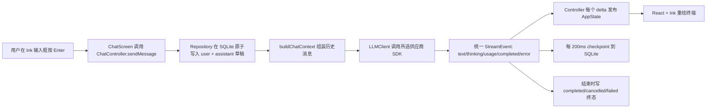

# MyCode 源码导读（面向 TypeScript 初学者）

## 1. 先建立正确的项目认识

MyCode 当前是一个运行在 Windows Terminal 中的全屏 AI **聊天客户端**，不是会读取代码、编辑文件或执行命令的完整 coding agent。它已经实现了 coding agent 的一部分基础设施：多轮上下文、流式模型调用、取消、会话管理、持久化和终端 UI；但 `AGENT.md` 明确规定当前不实现 tool use、function calling、MCP、Shell 命令或项目文件读写。

它支持三种模型协议：

- Anthropic Messages；
- OpenAI Responses；
- OpenAI Chat Completions（也可连接兼容接口）。

多轮对话的本质并不是模型在本地“记住”了什么，而是程序每次请求前从 SQLite 取出本会话历史，经 `buildChatContext` 筛选后再次发送给模型。

## 2. 一次消息如何穿过整个系统



项目刻意把职责分开：UI 不认识模型 SDK，Controller 不认识 SQLite，Provider 不认识 React。各层只通过 TypeScript 接口和联合类型沟通。

## 3. 文件结构总览

```text
MyCode/
├─ src/                    运行时代码
│  ├─ bin/                命令入口
│  ├─ cli/                参数解析与应用装配
│  ├─ config/             YAML/.env 加载、校验和类型
│  ├─ providers/          三种模型协议及统一接口
│  ├─ chat/               对话状态、上下文、业务控制器
│  ├─ storage/            SQLite、Worker、迁移、仓储
│  ├─ terminal/           终端实例和安全退出
│  ├─ tui/                React + Ink 终端界面
│  └─ shared/             通用错误、ID 和时间
├─ tests/                 单元、集成、TUI 测试及测试夹具
├─ examples/              配置示例
├─ spec_docs/             需求、设计计划和验收清单
├─ coverage/              Vitest 自动生成的覆盖率网页，不手工维护
├─ package.json           依赖、命令和 Node 版本约束
├─ tsconfig*.json         TypeScript 检查/构建配置
├─ vitest.config.ts       测试配置
├─ eslint.config.js       静态检查配置
├─ README.md              用户使用说明
└─ AGENT.md               本仓库开发约束
```

`dist/` 若存在，是 `npm run build` 生成的 JavaScript 和 `.d.ts`，不是源码。`node_modules/` 是安装的依赖，也不属于本项目实现。

## 4. 阅读前需要知道的 TypeScript 语法

- `interface X { ... }` 描述对象必须有什么字段，本身不会生成运行时代码。
- `type A = X | Y` 是联合类型，表示值可以是 X 或 Y。
- `event.type === 'text_delta'` 会让 TypeScript 自动缩小联合类型，从而知道 `event.text` 存在，这叫“判别联合”。
- `field?: string` 表示属性可以缺省；`string | null` 表示属性一定存在，但值可能为空。
- `import type` 只导入类型，编译为 JavaScript 后会消失。
- `as const` 保留字面量类型和只读性，例如 `'anthropic'` 不会被扩大成普通 `string`。
- `readonly` 防止通过当前引用重新赋值；`#field` 则是 JavaScript 运行时真正的私有字段。
- `async function` 返回 `Promise`；`async *function` 返回异步迭代器，可用 `for await...of` 持续接收流。
- `AbortController`/`AbortSignal` 是标准取消机制，Controller 调用 `abort()` 后 SDK 请求会停止。
- `{...old, field: value}` 创建一个修改了部分字段的新对象。这个项目用不可变更新帮助 React 识别状态变化。
- `.tsx` 是允许写 JSX 的 TypeScript。这里的 `<Box>`、`<Text>` 最终不是网页 DOM，而是 Ink 的终端组件。
- 源码导入写 `.js` 是 NodeNext/ESM 的要求：TypeScript 源文件虽是 `.ts`，构建后实际运行的是 `.js`。

## 5. 运行时代码逐文件说明

### 5.1 命令入口与启动

- `src/bin/mycode.ts`：可执行文件入口。去掉 `process.argv` 的前两项后解析用户参数，调用 `bootstrap`；命令用法错误退出码为 2，其他启动错误为 1。第一行 shebang 让构建产物能作为命令运行。
- `src/cli/args.ts`：手写的小型参数解析器，只接受 `--help` 与 `--profile <name>`，并拒绝重复、缺值、未知参数和冲突组合。`CliOptions.profile?` 演示了可选属性。
- `src/cli/bootstrap.ts`：整个程序的“组合根”。检查 Windows 与 Node 24，加载配置，创建 Provider、Repository、Controller 和 Ink UI，注册未处理异常，最后统一清理资源。依赖在这里组装，所以业务类内部不需要到处 `new` 具体实现。

### 5.2 配置

- `src/config/types.ts`：定义协议、thinking 配置、原始 YAML profile、应用内部 profile 和安全的 `ProfileSummary`。`Protocol = (typeof protocols)[number]` 从数组自动推导字符串联合。
- `src/config/schema.ts`：用 Zod 验证外部 YAML。单字段规则包括非空、URL、环境变量引用；`superRefine` 处理 profile 重名和“非 Anthropic 不得启用 thinking”这种跨字段规则；`normalizeThinking` 把 YAML 简写变成统一内部结构。
- `src/config/secrets.ts`：错误显示前，用 `[REDACTED]` 替换所有已加载 API Key。
- `src/config/loader.ts`：固定读取 `%USERPROFILE%\.mycode\config.yaml` 和 `.env`；依次完成文件读取、YAML 解析、Zod 校验、环境变量替换和字段命名转换。`resolveProfile` 决定直接进入聊天还是显示选择页。

配置数据经历两步转换：

```text
YAML unknown
  -> ProviderProfileSource（结构已校验，api_key 仍为 ${NAME}）
  -> ProviderProfile（API Key 已解析，字段已标准化）
  -> ProfileSummary（只给 UI 的安全字段）
```

### 5.3 通用工具

- `src/shared/errors.ts`：自定义错误基类和三种语义错误。构造器用 `new.target.name` 保留真实子类名；`errorMessage` 安全处理 `unknown`。
- `src/shared/ids.ts`：集中创建 UUID 和毫秒时间戳，供数据库主键、Worker 请求 ID 与排序使用。

### 5.4 Provider 抽象与三种协议

- `src/providers/types.ts`：最重要的供应商边界。`LLMClient` 只暴露一个返回 `AsyncIterable<StreamEvent>` 的 `streamChat`；所有 SDK 原始事件都要变成 text、thinking、usage、completed 或 error。这里也定义 Responses API 的重放状态及运行时类型守卫。
- `src/providers/errors.ts`：把 SDK/HTTP/网络错误归一为 authentication、rate_limit、network 等错误码，判断是否可重试，并在返回前脱敏。`isAdaptiveThinkingUnsupported` 刻意只匹配非常明确的 400 错误，避免错误重试。
- `src/providers/factory.ts`：根据 profile.protocol 创建三个具体客户端之一。`assertNever` 让未来新增协议但漏改 `switch` 时产生类型错误。
- `src/providers/anthropic.ts`：调用 Anthropic Messages 流。解析文本、thinking、usage 和结束原因；`thinking: true` 先尝试 adaptive，且只有“尚未输出任何 delta + 服务端明确不支持 adaptive”时回退到 4096/8192 的 manual thinking。
- `src/providers/openai-responses.ts`：调用 Responses API，设置 `store: false`。完成时保存完整 `response.output`；下一轮优先重放这些 output items，因为它们可能包含普通文本之外的协议状态。损坏状态会安全退回 role/content 文本。
- `src/providers/openai-chat.ts`：调用 Chat Completions/兼容接口。逐 chunk 提取 `choices[].delta.content`，映射 finish reason，并通过 `stream_options.include_usage` 请求 token 用量。

### 5.5 存储层

- `src/storage/types.ts`：定义 Session、StoredMessage、消息状态、终态更新和 Controller 依赖的 Repository 接口。`Exclude<MessageStatus, 'streaming'>` 从类型上禁止 finalize 后仍写 streaming。
- `src/storage/worker-protocol.ts`：定义主线程与存储 Worker 之间的 RPC 协议。每个请求都有 requestId，客户端用它找回对应 Promise。
- `src/storage/migrations/001-initial.ts`：第 1 版 SQLite 表结构，包括迁移记录、会话表、消息表和索引。thinking、错误、usage、provider state 都可持久化。
- `src/storage/migrations/index.ts`：迁移执行器。查询已应用版本，每个新迁移都在 `BEGIN IMMEDIATE`/`COMMIT` 事务中执行，失败则 `ROLLBACK`。
- `src/storage/worker.ts`：唯一直接导入 `node:sqlite` 的运行时文件。它在 Worker 线程中使用同步 SQLite API，因此不会阻塞主线程的键盘与 UI；负责 CRUD、事务、数据库行转换、JSON 状态恢复和 RPC 回包。`begin_turn` 在一个事务里同时写 user 消息与 assistant 草稿。
- `src/storage/worker-client.ts`：主线程的 Worker RPC 客户端。`Map<requestId, {resolve,reject}>` 保存待完成 Promise；收到回包时配对完成；Worker 崩溃则拒绝全部等待项。开发模式下 Worker 仍使用构建后的 `dist/storage/worker.js`。
- `src/storage/repository.ts`：业务友好的门面，把 `createSession()` 等方法翻译成 Worker operation，同时隔离 Controller 与线程通信细节。

为什么使用 Worker：Node 24 的 `DatabaseSync` 很直接可靠，但同步数据库调用会阻塞事件循环。放进 Worker 后，主线程只等待异步消息，流式刷新和键盘输入不会被 SQLite 卡住。

### 5.6 聊天业务层

- `src/chat/state.ts`：定义 UI 所需的单一 `AppState` 和初始状态；`replaceMessage` 用 `map` 创建新数组，保持 React 友好的不可变更新。
- `src/chat/context.ts`：构造下一轮模型历史。保留 completed user/assistant 和有正文的 cancelled assistant；排除 failed、空取消项和 thinking 展示文本；有 Responses providerState 时一并带上。
- `src/chat/controller.ts`：全项目的业务中枢。它初始化/切换会话、发送/取消请求、消费流事件、发布状态、节流 checkpoint、最终落盘和安全关闭。UI 通过 `subscribe/getState` 观察它。

`ChatController.sendMessage` 的细化顺序：

1. 拒绝关闭后的调用、并发请求和空文本。
2. `beginTurn` 原子写入 user 消息与 streaming assistant 草稿。
3. 立刻发布新状态，让用户输入马上出现。
4. 建立 `AbortController`，调用 `#consume`。
5. `#consume` 组装历史，并 `for await` 消费统一 Provider 事件。
6. 每个文本/thinking delta 立即发布 UI，但数据库 checkpoint 合并为约 200ms 一次。
7. completed/error/abort 后先冲刷 checkpoint，再把消息写成 completed/failed/cancelled。
8. 正常完成会折叠 thinking；失败显示错误；取消保留已经生成的内容。

### 5.7 终端生命周期

- `src/terminal/session.ts`：包装 Ink Instance，提供等待退出与幂等 unmount。
- `src/terminal/shutdown.ts`：创建一个只真正执行一次的关闭函数。多个退出来源共享同一个 Promise，先关闭 Controller/数据库，再卸载终端。

### 5.8 TUI（React + Ink）

- `src/tui/render.tsx`：调用 Ink `render`。备用屏幕让退出后恢复原终端；禁用 Ink 默认 Ctrl+C，由业务判断是取消生成还是退出。
- `src/tui/keys.ts`：集中记录快捷键常量；当前界面判断主要直接使用 Ink 的 key 对象，这份文件更像快捷键词典。
- `src/tui/hooks/use-chat-controller.ts`：用 `useSyncExternalStore` 把非 React 的 ChatController 状态安全接入 React。
- `src/tui/app.tsx`：顶层页面路由。按终端过小、已有 Controller、加载中、profile 选择四种情况渲染；用户选择 profile 后异步创建 Controller。
- `src/tui/screens/profile-select-screen.tsx`：多 profile 的上下选择页。`useRef` 保存即时索引，`useState` 负责触发重绘。
- `src/tui/screens/chat-screen.tsx`：键盘交互中心。管理输入草稿、焦点、滚动偏移和会话浮层；把 Ctrl+C、Ctrl+N、Ctrl+O、Tab、PageUp/Down、方向键、Enter 翻译成 Controller 操作。
- `src/tui/screens/terminal-too-small-screen.tsx`：窗口小于 60×16 时的降级页，避免复杂布局崩坏，同时允许 Ctrl+C 退出。
- `src/tui/components/error-banner.tsx`：错误为空时渲染 null，否则显示红色错误框。
- `src/tui/components/message.tsx`：显示单条消息的角色、状态、thinking、正文和错误。生成中的 thinking 强制展开。
- `src/tui/components/message-list.tsx`：显示消息窗口。通过 `height / 3` 粗略计算可见条数，再结合 offset 截取尾部历史；这是简单窗口化，不是精确按终端行测量。
- `src/tui/components/prompt-input.tsx`：受控输入框，只展示父组件传入的 draft/focus/disabled。
- `src/tui/components/session-list.tsx`：覆盖在聊天页上的历史会话浮层，显示标题和本地格式更新时间。
- `src/tui/components/status-bar.tsx`：显示 profile、model、请求状态、供应商实际上报的 token 和快捷键提示。
- `src/tui/components/thinking-block.tsx`：thinking 为空时不渲染；否则显示生成/折叠状态，并按 expanded 决定是否展示正文。

## 6. 项目根文件逐份说明

- `package.json`：声明 ESM 项目、Node 24、`MyCode` 命令、依赖和 npm scripts。`check` 串联类型检查、lint、测试和构建。
- `package-lock.json`：锁定依赖的精确版本和完整依赖树，由 npm 管理，不手工编辑。
- `tsconfig.json`：源码和测试共用的严格类型检查。值得注意的选项有 `strict`、`noUncheckedIndexedAccess`、`exactOptionalPropertyTypes`、`useUnknownInCatchVariables` 和 NodeNext ESM。
- `tsconfig.build.json`：继承前者，只构建 `src` 到 `dist`，并生成声明文件和 source map。
- `vitest.config.ts`：指定 Node 测试环境、测试文件匹配、fork 进程池和 V8 覆盖率报告。
- `eslint.config.js`：启用 JS、TypeScript 类型感知和 React Hooks 规则，强制 type-only import 和处理 Promise。
- `README.md`：安装、配置、快捷键、检查命令和当前能力边界的用户文档。
- `AGENT.md`：维护者/自动化开发时必须遵守的范围与验证规则；明确只支持 Windows、使用中文注释、当前不做工具型 agent。
- `examples/config.example.yaml`：三种协议和 thinking 配置的可复制示例，不含真实密钥。
- `spec_docs/spec.md`：产品需求、功能/非功能要求、明确不做的功能和验收标准。
- `spec_docs/plan.md`：原始架构计划和实现策略。
- `spec_docs/task.md`：把实现拆成有依赖关系的工程任务。
- `spec_docs/checklist.md`：自动化与人工端到端验收清单；未勾选不必然代表代码失败，也可能只是缺少真实 API/终端人工验证。
- `coverage/`：`npm run test:coverage` 自动生成的 HTML、CSS、JS 和逐文件报告。它是结果，不是需要阅读或注释的实现代码。

## 7. 测试代码逐份说明

### 测试辅助设施与 fixture

- `tests/helpers/mock-llm-client.ts`：实现同一个 `LLMClient` 接口，按顺序 yield 预设事件并记录请求，用于不联网测试 Controller。
- `tests/helpers/mock-sse-server.ts`：启动本机随机端口 HTTP/SSE 服务，记录 URL、body、Authorization，并按帧发送流，用于模拟真实 SDK 网络行为。
- `tests/helpers/mock-sse-server.test.ts`：验证模拟 SSE 服务确实分块发送并能释放端口。
- `tests/fixtures/configs/valid.yaml`：合法配置输入夹具。
- `tests/fixtures/configs/invalid.yaml`：非法配置输入夹具。
- `tests/fixtures/streams/anthropic.txt`：Anthropic SSE 示例帧。
- `tests/fixtures/streams/openai-chat.txt`：Chat Completions SSE 示例帧。
- `tests/fixtures/streams/openai-responses.txt`：Responses API SSE 示例帧。

### 单元测试

- `tests/unit/cli/args.test.ts`：覆盖空参数、help、profile 和参数错误。
- `tests/unit/config/schema.test.ts`：覆盖 thinking 归一化、重复名称、协议限制、URL 和密钥引用。
- `tests/unit/config/loader.test.ts`：用临时主目录验证固定路径、多/单 profile、缺文件/变量和未知 profile。
- `tests/unit/config/secrets.test.ts`：验证多个 profile 的密钥都会从字符串中清除。
- `tests/unit/providers/anthropic.test.ts`：验证 thinking/text 转换、adaptive 到 manual 的严格回退边界和认证错误不回退。
- `tests/unit/providers/openai-responses.test.ts`：验证 `store: false`、output items 重放和损坏状态降级。
- `tests/unit/providers/openai-chat.test.ts`：验证文本、completed 和 usage 事件转换。
- `tests/unit/providers/errors.test.ts`：验证错误分类与密钥脱敏。
- `tests/unit/providers/factory.test.ts`：验证三个 protocol 创建三个不同实现。
- `tests/unit/chat/context.test.ts`：验证历史排序、状态筛选、thinking 排除和 providerState 保留。
- `tests/unit/chat/state.test.ts`：验证初始页面和 state 中不包含 API Key。
- `tests/unit/storage/migrations.test.ts`：验证迁移创建 schema 且可以重复执行。
- `tests/unit/storage/repository.test.ts`：验证 profile 数据隔离和会话更新时间排序。

### 集成与 TUI 测试

- `tests/integration/provider-streaming.test.ts`：从统一接口角度确认 completed 前有多个 delta，并可带 usage。
- `tests/integration/chat-controller.test.ts`：连接真实 Repository Worker 与假 LLM，验证逐块状态、持久化和第二轮完整上下文。
- `tests/integration/storage-worker.test.ts`：关闭并重新打开真实临时 SQLite，验证正文、thinking、usage、状态和 Responses replay state 均能恢复。
- `tests/tui/app.test.tsx`：用 Ink 测试渲染状态栏中的 profile、model、状态和 usage。
- `tests/tui/chat-screen.test.tsx`：验证消息 Unicode、换行和 thinking 展示。
- `tests/tui/keyboard.test.tsx`：验证 profile 页方向键与 Enter 选择。

## 8. 推荐阅读顺序

如果你只是“大概会 JavaScript，还不熟 TS”，建议不要按目录字母顺序读：

1. `src/providers/types.ts`：先理解项目各层交换的数据。
2. `src/storage/types.ts` 与 `src/chat/state.ts`：理解数据库对象和 UI 状态。
3. `src/chat/context.ts`：这是多轮对话最短、最直接的核心。
4. `src/chat/controller.ts`：沿 `initialize -> sendMessage -> #consume -> shutdown` 阅读。
5. `src/providers/openai-chat.ts`：三个 Provider 中最简单的一份。
6. `src/providers/openai-responses.ts`、`anthropic.ts`：再看协议特有逻辑。
7. `src/storage/repository.ts -> worker-client.ts -> worker.ts`：顺着一次数据库调用走完整链路。
8. `src/tui/screens/chat-screen.tsx -> components/*`：最后看输入如何变成 Controller 操作、状态如何变成终端画面。
9. `src/cli/bootstrap.ts -> src/bin/mycode.ts`：回到最外层，把所有对象如何组装起来补齐。

读代码时可以选一条具体路径追踪，例如搜索 `sendMessage`、`text_delta`、`begin_turn` 或 `requestId`，比一次理解所有类型更容易。

## 9. 当前实现中值得留意的边界

- `screen` 与 `keys` 类型目前比实际 UI 使用范围更宽，有些值/常量是为结构完整或未来扩展保留的。
- 消息列表按“每条约 3 行”估算可见数量，长消息并非精确滚动。
- Provider 的 SDK 事件在边界处做了最小结构映射，SDK 升级后应优先检查对应 Provider 测试。
- 真实供应商、Windows 备用屏、窗口缩放与强制终止仍需要人工端到端验收；自动化测试不使用真实 API Key 或外网。
- 若未来要把它升级为真正 coding agent，至少还需要工具协议、权限/审批、项目上下文、文件编辑、命令执行及工具结果回灌；这些能力当前都不存在。
