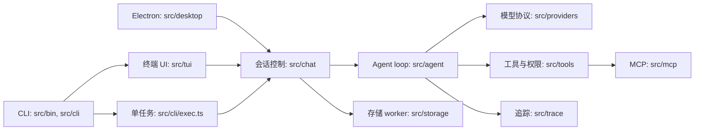

# 当前架构

核对日期：2026-11-04。以下是当前实现的代码导航与主要数据路径，非完整依赖图；产品意图见 [项目意图](intent.md)。

入口 `src/bin/bitori.ts` 解析参数，`src/cli/bootstrap.ts` 加载配置、设置日志与脱敏，选择终端、`exec` 或观察子命令。终端使用 Ink/React 渲染，默认 alternate screen，视觉沿用 Devin CLI 的深色对话流：`/` 打开斜杠命令面板，`/model` 切换模型配置，`/new`、`/sessions`、`/diff` 管理会话与改动侧栏；工具调用在模型流式生成参数时就显示草稿，完成后显示参数、状态与输出，`Ctrl+O` 展开全部细节，`Ctrl+/-` 调整排版密度。助手回复完成后按安全 Markdown 渲染：终端呈现标题、列表、对齐表格、代码块与链接。桌面端沿用 Claude Desktop 的深色工作台布局，同样支持斜杠命令、工具卡片、Markdown 与 `Ctrl+/-` 页面缩放。工具调用按密度折叠：连续成功的 `read_file` / `search_text` / `find_files` 合成摘要，写操作在结果下内联双行号 diff。Linux Electron 入口通过 preload 和 IPC 连接界面与同一会话控制器。`src/app/runtime.ts` 是 CLI 与桌面端共用的组合根，统一创建模型客户端、工具系统、MCP、Hook、仓储和控制器。`ChatController` 管理会话状态和事件投影，`session-prompt.ts` 负责会话提示的组装，`AgentRunner` 驱动模型请求、工具执行和回写。`src/prompt/` 组装提示，`src/compact/` 处理上下文压缩。不同供应商通过 `src/providers/` 适配。

Provider 请求提供 `items` 时始终使用该有序上下文，即使它为空或渲染后为空；只有未提供 `items` 才使用兼容字段 `messages`。流中的工具调用由 `StreamCollector` 汇集，再由 `ToolPolicy` 校验和分类。Qoder Cloud Agents 的 Agent 配置显式关闭服务端内置工具（Bash 白名单 + 权限禁用），只暴露本地工具为 client-side custom tools；服务端 `requires_action` 只应来自这些自定义工具，由本地 Runner 执行并回传结果。会话复用遇到服务端 busy 锁时，客户端会中断旧 turn，换新会话并发送完整转录。

`src/tools/create-tool-system.ts` 注册六个基础工具及扩展工具；内置工具的 JSON Schema 由 Zod 输入 schema 生成。`permission-engine.ts` 先处理危险命令和文件真实路径，再应用规则、权限档及审批。文件路径边界不限制获准命令或 MCP 的外部访问。`src/mcp/` 负责发现、传输和适配；`src/skills/`、`src/hooks/`、`src/subagents/`、`src/teams/`、`src/worktree/` 实现对应扩展。关闭控制器时会取消并等待后台记忆提取；工具系统关闭时等待 MCP 和 Agent 服务清理。

`src/storage/repository.ts` 通过 worker 操作 SQLite，Agent Run/Iteration 是当前的回合写入接口；旧数据库中的消息和工具记录仍可读取。终端默认使用用户目录数据库，`exec` 使用工作区数据库。日志、每会话 JSONL trace 和技能/命令统计在用户目录的 `logs/`、`traces/`、`usage/`。trace 写入包含脱敏处理，但可能含工作区内容；不可视为无敏感数据。trace 默认保留 30 天，日志默认 7 天，配置见 `src/config/schema.ts`。

测试分布在 `tests/unit/`、`tests/integration/`、`tests/tui/` 和 `tests/acceptance/`；公开基准接入和 RSI 实验工具在 `evaluation/`。从一次调用追踪时可依次查看 `src/chat/agent-controller.ts`、`src/agent/runner.ts`、`src/tools/executor.ts` 和对应 provider、存储或 trace 测试。

## 评测与 RSI 控制面

`evaluation/RSI/` 是独立于运行时 harness 的 Python 控制面：runner 从固定基准 SHA 构建被测版本并记录安全证据，`analyze.py` 做保守的规则诊断，`loop.py` 在预算内编排基线、候选分支、可信检查、配对评测和 verifier 决策。候选代码只在临时容器中构建和执行；真实模型密钥仅注入可信转发器 `model_gateway.ts`，执行容器只持有实验级短期令牌并连接内部网络。`verifier.py` 是纯决策函数，只接受绑定 experiment/base/head/verifier SHA 的可信执行回执，从不写 Git 或授权合并；`report.json` 的 `merge_authorized` 恒为 false，合并仍由人工审查和仓库规则决定。

该控制面的离线测试和既有评测均有记录；额外的 Docker 基准扩跑与云端 RSI 复验需各自取得明确授权，不属于常规产品运行。实验结果及运行边界见[评测说明](reference/evaluation.md)。trace 与评测证据仍可能包含工作区内容，只在明确白名单和脱敏后上传。

## 桌面进程边界

Linux 桌面端选择 Electron，以复用 TypeScript 业务核心和 SQLite Worker，代价是更大的打包体积和运行时资源占用。业务控制器、配置、存储和工具执行留在主进程；渲染进程开启沙箱和上下文隔离，通过 preload 的受限 IPC 操作界面。助手回复使用本地安全 Markdown 渲染器（标题、列表、表格、引用、代码块、行内代码与链接），原始 HTML 不执行、图片不加载；外链只允许 HTTP(S)/mailto，并由主进程 `shell.openExternal` 打开。切换工作区前要求确认信任，再重建工作区服务。界面只展示真实可用的状态与操作：工作区、profile、会话、最近回合用量、Agent 模式与权限档；不伪造登录账户、产品模式或未实现的入口。桌面验收范围见下方状态映射。

## 诊断、信任与安全边界

`src/diagnostics/connection.ts` 用各协议的 `/models` 端点做真实连接探测，把 DNS/超时/401/404/协议不匹配/模型不存在归入 `ProviderErrorCode`；`bitori doctor` 复用同一探测输出配置、凭据、工作区与模型清单（永不打印密钥值）。接口方言可省略：`src/config/protocol.ts` 按密钥形状（Qoder PAT 的 `pt-` 前缀）与地址关键词（anthropic/claude、responses、chat/completions）推断，认不出时兜底为最常见的 OpenAI 兼容接口并标记为弱推断；优先级是 `config.yaml` 显式 > `.env` 的 `<前缀>_PROTOCOL` > 推断，doctor 的「协议」一项会显示结论与依据。工作区信任清单在 `~/.bitori/trusted-workspaces.json`；未信任工作区的项目配置、指令、记忆、skills、commands、agents 与权限规则默认拒载。清单由 `bitori trust`、桌面信任对话框与 doctor 检查共同维护。文件修改撤销依赖 `src/tools/snapshots.ts`：edit/write 提交前记录改前内容，撤销要求当前内容仍等于 Bitori 写入结果（被外部修改则拒绝覆盖）；快照按写入时间排序，同一毫秒内的多次写入也能定位到最近一次。撤销目标由工作区相对路径推导而非快照里记录的绝对路径——同一文件在不同平台可能被写成 8.3 短名、展开后的符号链接路径或不同大小写，比较绝对路径会把合法快照误判成工作区之外。威胁模型、控制、验证证据与已知残留风险记录见 [安全模型与审计](reference/security.md)。

## 意图与实现状态

| 方向 | 状态 | 依据与后续 |
|---|---|---|
| 终端交互、模型协议、会话 | 已实现 | `src/tui/`、`src/providers/`、`src/storage/`；协议含 Anthropic、OpenAI Responses/Chat 与官方 Qoder Cloud Agents。Devin 风格对话流、`/` 命令面板、流式工具草稿、内联 diff、`Ctrl+O` 详情与 `Ctrl+/-` 密度已落地。`/model` 两级选择（profile → Provider 真实模型列表）、会话面板输入搜索 / `r` 重命名 / `d` 两步删除、`/undo` 撤销快照。Qoder 只上报 credits（`span.model_request_end`），UI/trace/存储显示 credits 而非伪造 0 tokens；busy 换会话、agent 版本 409 重取版本重试、断流带 `Last-Event-ID` 续读，事件形状由 `tests/fixtures/streams/qoder/` 真实录制回放。真实终端观感仍需按环境验收。 |
| 桌面工作台 | 已实现；Linux GUI/打包验收通过 | `src/desktop/`；Claude Desktop 风格深色布局、斜杠命令、流式工具卡片与 `Ctrl+/-` 页面缩放。edit/write 卡片默认展开行级 diff 并提供撤销按钮；审批有一次/本会话/永久/拒绝四种选择。smoke 覆盖四种选择、会话授权复用边界、diff/撤销、模型列表、图片/归档入口、会话管理和重命名编辑期间 caret 稳定；当前整合提交 run 41770535976 通过开发版、AppImage 与解包 deb 启动。 |
| 多轮工具、Plan/Do、权限、MCP | 已实现 | `src/agent/`、`src/tools/`、`src/mcp/`；命令和 MCP 不构成操作系统沙箱。 |
| 记忆、上下文压缩、扩展和可观察性 | 已实现基础能力 | `src/memory/`、`src/compact/`、`src/skills/`、`src/hooks/`、`src/trace/`；以实际代码为准。 |
| 自动化验收与模型兼容性 | 自动映射有单测；真实端点按配置逐项验收 | `tests/` 和 `.github/workflows/`；某个配置端点的图片请求结果只适用于该模型/endpoint，不代表其他协议或供应商；当前图片端点结果见[开发参考](reference/development.md)。 |
| 桌面图形应用 | Linux 初版已验收 | `src/desktop/` 提供 Electron 界面。当前整合提交 run 41770535976 已通过开发版、AppImage 和解包 deb 启动；Windows/macOS 桌面明确不在当前目标内。打包路径见 [开发与测试](reference/development.md)。 |
| 多模态、会话导入、自动断点续跑 | 实现、三平台 Check、SQLite 集成和 Linux 桌面验收通过 | 本地图片贯通 TUI/桌面及支持图像的 Provider；不支持图像的 Provider 明确拒绝；版本化 JSON 由 CLI/TUI/桌面交换；持久检查点恢复并要求不确定副作用确认。已配置图片端点的实测边界见[开发参考](reference/development.md)。 |
| 云同步 | 已取消，保持不支持 | 见 ADR 0001。 |

状态依据 2026-11-04 的代码与验证记录。Linux 隔离 PTY 核对实际 Ink 组件的 ANSI 光标行列；用户提供的 Ptyxis 截图确认提示区与文本末尾光标可见。RSI 与 SWE-bench Lite 的后续云端实验仍需授权；Windows/macOS 桌面不在范围内。
