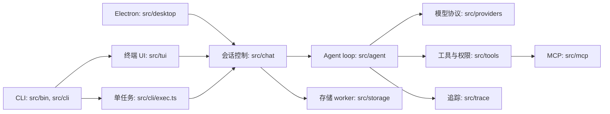

# 当前架构

核对日期：2026-10-27。以下是当前实现的代码导航与主要数据路径，非完整依赖图；产品意图见 [项目意图](intent.md)。

入口 `src/bin/bitori.ts` 解析参数，`src/cli/bootstrap.ts` 加载配置、设置日志与脱敏，选择终端、`exec` 或观察子命令。终端使用 Ink/React 渲染；Linux Electron 入口通过 preload 和 IPC 连接界面与同一会话控制器。`src/app/runtime.ts` 是 CLI 与桌面端共用的组合根，统一创建模型客户端、工具系统、MCP、Hook、仓储和控制器。`ChatController` 管理会话状态和事件投影，`session-prompt.ts` 负责会话提示的组装，`AgentRunner` 驱动模型请求、工具执行和回写。`src/prompt/` 组装提示，`src/compact/` 处理上下文压缩。不同供应商通过 `src/providers/` 适配。

Provider 请求提供 `items` 时始终使用该有序上下文，即使它为空或渲染后为空；只有未提供 `items` 才使用兼容字段 `messages`。流中的工具调用由 `StreamCollector` 汇集，再由 `ToolPolicy` 校验和分类。

`src/tools/create-tool-system.ts` 注册六个基础工具及扩展工具；内置工具的 JSON Schema 由 Zod 输入 schema 生成。`permission-engine.ts` 先处理危险命令和文件真实路径，再应用规则、权限档及审批。文件路径边界不限制获准命令或 MCP 的外部访问。`src/mcp/` 负责发现、传输和适配；`src/skills/`、`src/hooks/`、`src/subagents/`、`src/teams/`、`src/worktree/` 实现对应扩展。关闭控制器时会取消并等待后台记忆提取；工具系统关闭时等待 MCP 和 Agent 服务清理。

`src/storage/repository.ts` 通过 worker 操作 SQLite，Agent Run/Iteration 是当前的回合写入接口；旧数据库中的消息和工具记录仍可读取。终端默认使用用户目录数据库，`exec` 使用工作区数据库。日志、每会话 JSONL trace 和技能/命令统计在用户目录的 `logs/`、`traces/`、`usage/`。trace 写入包含脱敏处理，但可能含工作区内容；不可视为无敏感数据。trace 默认保留 30 天，日志默认 7 天，配置见 `src/config/schema.ts`。

测试分布在 `tests/unit/`、`tests/integration/`、`tests/tui/` 和 `tests/acceptance/`；公开基准接入和 RSI 实验工具在 `evaluation/`。从一次调用追踪时可依次查看 `src/chat/agent-controller.ts`、`src/agent/runner.ts`、`src/tools/executor.ts` 和对应 provider、存储或 trace 测试。

## 评测与 RSI 控制面

`evaluation/RSI/` 是独立于运行时 harness 的 Python 控制面：runner 从固定基准 SHA 构建被测版本并记录安全证据，`analyze.py` 做保守的规则诊断，`loop.py` 在预算内编排基线、候选分支、可信检查、配对评测和 verifier 决策。候选代码只在临时容器中构建和执行；真实模型密钥仅注入可信转发器 `model_gateway.ts`，执行容器只持有实验级短期令牌并连接内部网络。`verifier.py` 是纯决策函数，只接受绑定 experiment/base/head/verifier SHA 的可信执行回执，从不写 Git 或授权合并；`report.json` 的 `merge_authorized` 恒为 false，合并仍由人工审查和仓库规则决定。

该控制面的离线测试和既有评测均有记录；真实 Docker 隔离、受控云端 smoke、GitHub 必需检查与分支保护的验收状态见 [PLAN](PLAN.md)。trace 与评测证据仍可能包含工作区内容，只在明确白名单和脱敏后上传。

## 桌面进程边界

Linux 桌面端选择 Electron，以复用 TypeScript 业务核心和 SQLite Worker，代价是更大的打包体积和运行时资源占用。业务控制器、配置、存储和工具执行留在主进程；渲染进程开启沙箱和上下文隔离，通过 preload 的受限 IPC 操作界面，模型与工具内容按文本渲染。切换工作区前要求确认信任，再重建工作区服务。桌面验收范围见下方状态映射。

## 意图与实现状态

| 方向 | 状态 | 依据与后续 |
|---|---|---|
| 终端交互、三种模型协议、会话 | 已实现 | `src/tui/`、`src/providers/`、`src/storage/`；供应商和平台实际表现仍需分别验收。 |
| 多轮工具、Plan/Do、权限、MCP | 已实现 | `src/agent/`、`src/tools/`、`src/mcp/`；命令和 MCP 不构成操作系统沙箱。 |
| 记忆、上下文压缩、扩展和可观察性 | 已实现基础能力 | `src/memory/`、`src/compact/`、`src/skills/`、`src/hooks/`、`src/trace/`；以实际代码为准。 |
| 自动化验收与模型兼容性 | 持续完善 | `tests/` 和 `.github/workflows/`；真实端点测试按需运行，不等同完整供应商认证。 |
| 桌面图形应用 | Linux 初版 | `src/desktop/` 提供 Electron 界面；Linux 云端验证开发入口、会话与审批流程及打包后启动。AppImage/deb 可用于开发验证，其他桌面平台和真实模型需另行验收。 |
| 多模态、云同步、会话导入、自动断点续跑 | 当前不支持 | 是否纳入后续版本尚未确定。 |

状态依据 2026-10-27 的代码和验证记录；真实端点与平台验收须单独核实。
