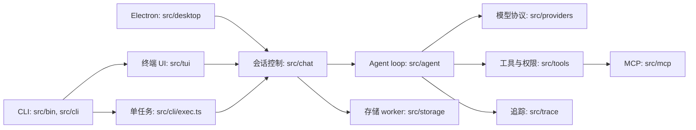

# 当前架构

核对日期：2026-10-27。以下是代码导航与主要数据路径，非完整依赖图。

入口 `src/bin/bitori.ts` 解析参数，`src/cli/bootstrap.ts` 加载配置、设置日志与脱敏，选择终端、`exec` 或观察子命令。终端使用 Ink/React 渲染；Linux Electron 入口通过 preload 和 IPC 连接界面与同一会话控制器。`src/app/runtime.ts` 是 CLI 与桌面端共用的组合根，统一创建模型客户端、工具系统、MCP、Hook、仓储和控制器。`ChatController` 管理会话状态和事件投影，`AgentRunner` 驱动模型请求、工具执行和回写。`src/prompt/` 组装提示，`src/compact/` 处理上下文压缩。不同供应商通过 `src/providers/` 适配。

`src/tools/create-tool-system.ts` 注册六个基础工具及扩展工具；`permission-engine.ts` 先处理危险命令和文件真实路径，再应用规则、权限档及审批。文件路径边界不限制获准命令或 MCP 的外部访问。`src/mcp/` 负责发现、传输和适配；`src/skills/`、`src/hooks/`、`src/subagents/`、`src/teams/`、`src/worktree/` 实现对应扩展。

`src/storage/repository.ts` 通过 worker 操作 SQLite：终端默认使用用户目录数据库，`exec` 使用工作区数据库。日志、每会话 JSONL trace 和技能/命令统计在用户目录的 `logs/`、`traces/`、`usage/`。trace 写入包含脱敏处理，但可能含工作区内容；不可视为无敏感数据。trace 默认保留 30 天，日志默认 7 天，配置见 `src/config/schema.ts`。

测试分布在 `tests/unit/`、`tests/integration/`、`tests/tui/` 和 `tests/acceptance/`；基准任务在 `benchmarks/`。从一次调用追踪时可依次查看 `src/chat/agent-controller.ts`、`src/agent/runner.ts`、`src/tools/executor.ts` 和对应 provider、存储或 trace 测试。
