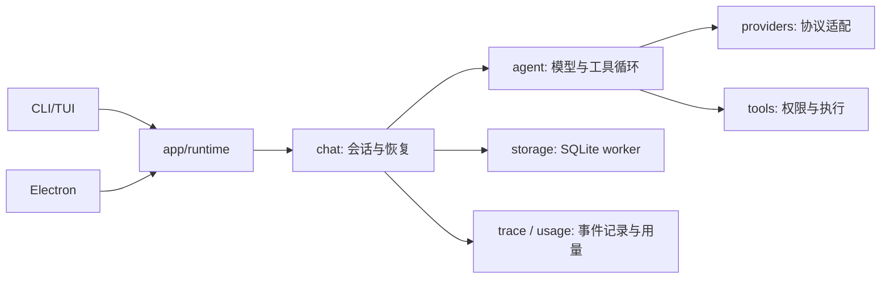

# 开发

## 命令与验证

需要 Node.js 24 和 npm。安装与启动见[项目 README](../README.md)，连接参数见[配置说明](configuration.md)。

| 命令 | 用途 |
|---|---|
| `npm run dev` | 源码启动终端界面 |
| `npm run build` / `npm start` | 编译至 dist，再启动编译入口 |
| `npm run desktop` | 构建并启动 Linux Electron 桌面 |
| `npm run desktop:package` | 构建 AppImage 和 deb |
| `npm run typecheck` / `npm run lint` | 类型与静态检查 |
| `npm test` | 先构建，再运行 Vitest |
| `npm run check` | 类型、lint、测试、构建完整检查 |
| `npm run test:tui:cursor:pty` | Linux PTY 检查 ASCII/CJK 输入后的 ANSI 光标行列，不验证像素外观 |

存储集成测试使用 `dist/storage/worker.js`，必须基于当前源码构建。[Check workflow](../.github/workflows/check.yml) 覆盖 Ubuntu、Windows、macOS；[桌面 workflow](../.github/workflows/desktop.yml) 覆盖 Linux 开发版及打包 smoke。重型构建、GUI、容器和大规模评测使用获授权的云端资源。

## 代码导航

下图概括当前会话执行路径，不包含全部依赖。



| 目录 | 职责 |
|---|---|
| `src/bin`、`src/cli`、`src/tui`、`src/desktop` | 参数、子命令、Ink/React 终端和 Linux Electron 界面 |
| `src/app`、`src/chat`、`src/agent` | 共用运行时、会话状态与恢复、流式收集、工具调度 |
| `src/providers` | Anthropic、OpenAI Chat/Responses、Qoder 协议适配 |
| `src/tools`、`src/mcp` | 本地工具、路径与权限、快照撤销、MCP 发现与传输 |
| `src/storage`、`src/trace`、`src/usage` | SQLite worker 与数据库迁移、脱敏追踪、用量统计 |
| `src/prompt`、`src/compact`、`src/memory` | 提示组装、上下文压缩与记忆 |
| `src/skills`、`src/commands`、`src/hooks`、`src/subagents`、`src/teams`、`src/worktree` | 可加载扩展与协作工具 |
| `tests`、`evaluation` | 单元/集成/TUI/验收测试，可选基准与 RSI 控制面 |

从[共用运行时](../src/app/runtime.ts)追踪到[会话控制器](../src/chat/agent-controller.ts)、[AgentRunner](../src/agent/runner.ts)、[工具执行器](../src/tools/executor.ts)及[存储仓储](../src/storage/repository.ts)，可定位一次请求的主要路径。trace 和用量由会话控制器订阅运行事件后记录。

桌面业务逻辑在主进程，渲染进程通过 preload 的受限 IPC 访问共用控制器；安全边界见[配置与安全](configuration.md#日志与安全边界)。Qoder 关闭服务端内置工具，仅执行本地 custom tools；busy 时中断旧 turn、切换会话并发送完整转录，断流支持 Last-Event-ID 续读。

## 真实模型与评测

真实端点调用可能计费，必须单独授权并显式开启，例如：

```sh
BITORI_E2E_PROVIDERS=1 BITORI_E2E_PROTOCOL=qoder npm run test:e2e:providers
```

脚本读取用户 `.env`；省略协议时自动推断，`BITORI_E2E_PRESET=image` 限一次聊天调用。输出写入忽略入库的 `evaluation/results/e2e-providers/`，包含被测提交与工作树状态。[E2E workflow](../.github/workflows/e2e.yml) 使用仓库模型配置，上传脱敏证据；token/credits 阈值是运行后判定，不是请求硬上限。

RSI 和 SWE-bench Lite 是可选实验，SWE-bench 扩跑保持暂停。后续运行须明确服务、凭据、发送数据范围和预算，历史授权不自动延续。

| 实验 | 入口与限制 |
|---|---|
| RSI | [workflow](../.github/workflows/rsi.yml) 手动触发，题目、候选范围与硬预算见 [smoke.json](../evaluation/RSI/smoke.json)。候选在隔离容器执行，只持短期令牌；真实密钥留在可信转发器。verifier 不写 Git、不授权合并，smoke 结论不作为合并依据 |
| SWE-bench Lite | [workflow](../.github/workflows/swe-bench-lite.yml) 覆盖 23 道开发题，并非正式 300 题。任务内容发给所配模型，容器执行模型命令，尚无总 token 或美元硬上限，扩跑前需另定预算 |

RSI/E2E 工作流要求从默认分支触发，执行前仍需审查该分支代码；分支检查本身不是密钥信任边界。运行结果保存在忽略入库的 evaluation/results/ 或 CI artifact；历史验收、决策与实验结论通过 Git 历史查阅。

## 生成文件

`dist/`、`out/`、`evaluation/results/`、`.tmp/` 和工具缓存不入库；对应进程退出后可清理，构建输出可重新生成。项目 `.bitori/` 是配置与数据，不能整体当缓存处理。CI artifact 按保留期过期，需要长期留存时应提前归档。

下载、解包、重型工具缓存使用项目 `.tmp/`，先建目录，再设置 `TMPDIR="$PWD/.tmp"`，避免占用 `/tmp` 的 tmpfs 配额。Qoder 录制和脱敏脚本默认使用 `.tmp/qoder-capture`；真实录制需另行授权，脱敏后再更新协议 fixtures。
